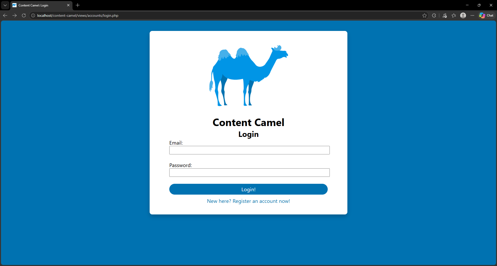

# Content Camel

Content Camel is a web application for creating, storing, and managing content posts. Built as an academic project, it provides a simple interface where users can register an account, write posts (either as drafts or published), organise them into categories, and search through them.

## Summary

"THE place to manage and store your content" — Content Camel lets authenticated users author posts with a title and body, tag them as drafts or posted, group them under categories, and browse/search their posts with filters such as text query, date range, status, and category. Posts are stored in a MySQL database and surfaced as cards on the "My Posts" page.

## Features

- **User accounts** — Register with forename, surname, email and password; log in and out. Sessions keep users authenticated.
- **Create posts** — Write a post with a title (up to 60 characters) and content (up to 3000 characters). Choose a status of **Draft** or **Posted** and assign/select a category (new categories are created on the fly).
- **Duplicate-save guard** — Prevents accidental duplicate posts when refreshing after submission (tracked via cookies).
- **My Posts dashboard** — View all of your posts as cards showing title, content preview, status (Draft/Posted) and category.
- **Search & filtering** — Basic text search across title and content, plus an advanced search panel with:
  - Date range (from/to)
  - Status filter (Draft / Posted / none)
  - Category filter (including an "uncategorised" option)
- **Edit posts** — Update title, content, status and category of an existing post.
- **Delete posts** — Remove a post with a confirmation prompt.
- **Character counters** — Live title/content character counts while writing.
- **Responsive layout** — Adjusts spacing for different viewport widths.

## Tech Stack

- **Backend:** PHP (procedural, with MySQLi)
- **Database:** MySQL
- **Frontend:** HTML, CSS, JavaScript (jQuery for AJAX)
- **Server:** Intended to run under XAMPP (Apache + PHP + MySQL) on `localhost`

## Project Structure

```
content-camel/
├── README.md
├── images/                 # Logo, backgrounds, placeholders
├── includes/
│   └── categoryhandler.php # Category lookup/creation logic
├── styles/                 # CSS stylesheets
└── views/
    ├── index.php           # Landing page (register / log in)
    ├── logOut.php          # Destroy session and redirect
    ├── accounts/           # Register, login, confirmations, email checks
    ├── create-post/        # Create a new post
    ├── edit-post/          # Edit / delete a post
    └── my-posts/           # My Posts dashboard + search (getposts.php)
```

## Database Schema (inferred)

The app expects a MySQL database with at least these tables:

- `ContentCamelUsers` — `userId`, `email`, `forename`, `surname`, `password`
- `ContentCamelPosts` — `postId`, `userId`, `title`, `content`, `dateCreated`, `categoryId`, `isPosted`
- `ContentCamelCategories` — `categoryId`, `userId`, `name`

## Getting Started

1. Install [XAMPP](https://www.apachefriends.org/) (or any Apache + PHP + MySQL stack).
2. Place this project in your web root (e.g. `C:\xampp\htdocs\content-camel`).
3. Run the provided `content_camel.sql` script to create the database and tables.
4. Update the hardcoded credentials in the PHP files (currently `"localhost", "username", "password", "database"`) to match your MySQL setup.
5. Start Apache and MySQL, then visit `http://localhost/content-camel/views/index.php`.

## How It Looks





## Notes & Caveats

- **Academic/demo project.** Several files contain a note from Future Christa: hardcoded credentials were used for academic demonstration purposes and should not be used in production.
- **Security:** The codebase uses string-concatenated SQL queries (SQL injection risk), stores passwords in plain text, and lacks input validation/CSRF protection. It is not production-ready, and again just written this way for academic demonstration purposes.
- **Config:** Database connection details are duplicated across many files rather than centralised.
